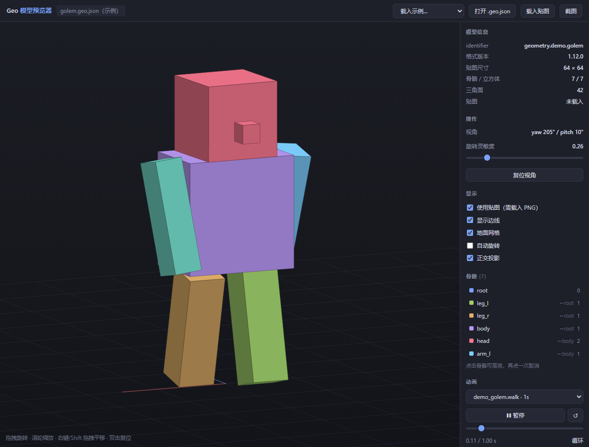

# Geo Model Previewer

一个用于预览 Minecraft Java 版 `.geo.json` 模型（Blockbench / GeckoLib 4 的 Bedrock 几何格式）的单文件网页工具。

无需安装、无需构建、无需联网——**双击 `index.html` 就能用**。



## 功能

**查看模型**
- 拖入 `.geo.json`，或点击「打开」选择文件
- 左键拖拽旋转（灵敏度可调）、滚轮缩放、右键 / Shift 拖拽平移、双击复位
- 正交投影 + z-buffer 遮挡，重叠/共面的立方体能正确显示
- 内置三个示例：碗、石魔像、石魔像 + 走路动画

**查看贴图**
- 拖入 PNG 贴图后按**真实 UV** 逐面铺图（仿射变换映射）
- 能一眼看出 UV 是否越界、是否错位、贴图有没有画到正确位置

**播放动画**
- 拖入 `.animation.json` 自动识别（按内容判断，不看文件名）
- 动画下拉切换、播放/暂停/重播、拖时间轴逐帧查看、调速、强制循环
- 逐帧采样 `rotation` / `position` / `scale` 三条轨道，支持 `pre`/`post` 关键帧

**检查结构**
- 右侧显示 identifier、格式版本、贴图尺寸、骨骼数、立方体数、三角面数
- 骨骼树带颜色、父级关系和立方体数量
- 点击骨骼高亮该部件，其余部分变半透明，方便定位问题

**导出**
- 一键截图保存为 PNG

## 使用

```
直接打开 index.html，或
把 .geo.json / .animation.json / .png 拖进页面
```

### URL 参数

| 参数 | 说明 | 示例 |
|---|---|---|
| `sample` | 载入内置示例 | `?sample=bowl` / `golem` / `golemAnim` |
| `url` | 载入远程模型 | `?url=./model.geo.json` |
| `tex` | 载入贴图 | `?tex=./skin.png` |
| `anim` | 载入动画 | `?anim=./walk.animation.json` |
| `highlight` | 高亮指定骨骼 | `?highlight=head` |
| `yaw` / `pitch` | 初始视角 | `?yaw=205&pitch=28` |
| `sens` | 旋转灵敏度 | `?sens=0.4` |

> `url` / `tex` / `anim` 在 `file://` 下会被浏览器同源策略拦截，需要起一个本地服务器，例如
> `python -m http.server 8000`，然后访问 `http://localhost:8000`。

## 支持的格式

**模型**：`.geo.json`
- `format_version` `1.12.0`（`minecraft:geometry` 数组）和 `1.8.0`（`geometry.*` 键）都支持
- 骨骼层级、`pivot`、`rotation`、`locators`
- 立方体 `origin` / `size` / `uv` / `inflate` / `mirror` / `pivot` / `rotation`
- UV 支持盒子展开图 `[u, v]` 和逐面 `{north: {uv, uv_size}}` 两种写法

**动画**：`.animation.json`
- `loop`：`true` / `false` / `"hold_on_last_frame"`
- `bones.<name>.rotation` / `position` / `scale`
- 关键帧 `pre` / `post`、`lerp_mode`（线性插值实现）

## 实现说明

- 纯 Canvas 2D，自己实现矩阵变换、正交投影、z-buffer 光栅化和仿射贴图，**零依赖**
- 模型预计算立方体局部顶点，每帧只重算骨骼矩阵，动画播放流畅
- 单文件约 45 KB，无外部资源

## 相关

配套的 Agent Skill（模型生成 / 校验 / 动画制作脚本）：
- `minecraft-geo-model` —— `.geo.json` 与 `.animation.json` 的生成、校验、命令行渲染预览

## License

MIT
